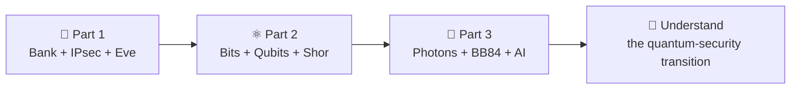

# 🔐 Quantum Security 101

### From Breaking RSA to Quantum Key Distribution with AI

**One fictional bank. Three interactive notebooks. A journey from classical encryption to quantum-safe communication.**

**28 October 2026 · 12:00–1:00 PM (Bahrain time) · Gulf Convention Centre, Gulf Hotel, Bahrain**

**Workshop conducted by Limnesh Augustine**  
Project Manager · Gulf Business Machines (GBM), Bahrain

[**🚀 START THE WORKSHOP**](#-open-the-three-notebooks) · [**🧪 THE EXPERIMENTS**](#-what-youll-explore) · [**👨‍🚀 ABOUT THE PRESENTER**](#-about-the-presenter) · [**📚 RELATED PROJECTS**](#-continue-exploring)

---

## 👋 Welcome, quantum explorers!

Imagine you are the security administrator of **Bahrain Sample Bank (BSB)**, a fictional bank with a production data centre in **Manama**, a disaster-recovery site in **Sitra**, and another in **Dubai**.

Your bank encrypts its communications. **Eve** records a protected exchange today, hoping that tomorrow's quantum computers will let her read it. Can she? What does Shor's algorithm actually attack? And could photons help Alice and Bob agree on fresh secret keys instead?

We will answer those questions by **running the experiments**, not just looking at slides.

> **No quantum computer, laser, or Python installation is needed.** A laptop, web browser, internet connection and Google Colab are sufficient for the simulated labs.

## 🚀 Open the three notebooks

Work through them **in order**. Each notebook contains explanations, runnable Python cells and interactive controls.

| | Workshop notebook | Launch in Google Colab | What you will do |
|---|---|---|---|
| **01 🏦** | **BSB Banking, IPsec & Harvest Now–Decrypt Later** [`01_ClassicalSecurity.ipynb`](https://github.com/limnesh/BITEX/blob/main/01_ClassicalSecurity.ipynb) |  | Observe key exchange, encrypt a banking record, and see what Eve can record. |
| **02 ⚛️** | **From Classical Bits to Qubits and Shor's Algorithm** [`02_QuantumComputing.ipynb`](https://github.com/limnesh/BITEX/blob/main/02_QuantumComputing.ipynb) |  | Experiment with Bloch spheres, gates, measurements, and the quantum threat to public-key cryptography. |
| **03 🔦** | **Quantum Key Distribution, Satellites & Machine Learning** [`03_QKDandML.ipynb`](https://github.com/limnesh/BITEX/blob/main/03_QKDandML.ipynb) |  | Send simulated photon pulses; explore BB84, Eve, QBER, reconciliation, privacy amplification, SKR and AI. |

**📂 [Browse all workshop files on GitHub](https://github.com/limnesh/BITEX)**

**If a Colab button cannot find a file:** open the [BITEX repository](https://github.com/limnesh/BITEX), select the corresponding numbered `.ipynb` notebook, or open [Google Colab](https://colab.research.google.com/), choose **File → Open notebook → GitHub**, search for `limnesh/BITEX`, and select the notebook.

### ▶️ How to run a lab

1. Click **Open in Colab** for the notebook you want. Sign in to Google if prompted.
2. In Colab, run the **Setup / Initialization** code cell near the beginning using the **▶** button. Allow the first installation to finish.
3. Follow the notebook from top to bottom. **🔵 LIVE — Step 1, Step 2, Step 3…** are the guided workshop activities. **🟠 OPTIONAL** means extra exploration afterward.
4. Change a slider, select a basis or gate, press **Measure**, and **observe how the results change**. Execute each experiment's cell before using its controls.
5. To keep your experiments, choose **File → Save a copy in Drive**. Your own copy can be edited without changing this repository.

**Tip:** If an import fails, run the notebook's Setup cell. If you have executed cells out of order and a variable is missing, use **Runtime → Restart session** and run the cells again in sequence. A standard CPU runtime is sufficient for these demonstrations.

---

## 👨‍🚀 About the presenter — Limnesh Augustine

**Limnesh Augustine** is an **Electronics and Communication Engineer**, **Project Manager at Gulf Business Machines (GBM), Bahrain**, internationally recognized **3D painting and anamorphic artist**, and an **EASA-licensed Private Pilot (Aeroplane)**. His journey connects **technology, aviation, art and innovation**—bringing an unusual combination of engineering practice, creative thinking and hands-on experimentation to this workshop.

### 🎨 Art without boundaries

Limnesh is internationally known for his large-scale **3D paintings and anamorphic street art**, which transform ordinary spaces into striking optical illusions. He is a **multiple Guinness World Record holder**, with achievements in **Bahrain and the United States**, and holds the prestigious **Madonnari title from Italy**. Explore his work at **[3DCouple.com](https://3dcouple.com/)**.

He has been regularly invited to create and present art at government, aviation, cultural and international events in **Bahrain, India, the United States, Germany, Italy, France, the Netherlands, Austria, the Czech Republic, Switzerland, Turkey, Malaysia, Bangladesh and the UAE**.

### 🌍 Art, sustainability and global initiatives

His creative work has included official collaborations and partnerships with international organizations such as **FAO, UNDP, WHO and WWF**, alongside contributions to United Nations-related initiatives. He attended **UN COP28 in the UAE as a delegate** and participated in the **artist-focused agenda preparation for the UN Summit of the Future 2024**. He is also an active member of an **Art and Culture working group**, advocating for the role of artists in wider public and global conversations.

### 💻 Engineering, cybersecurity and quantum research

Professionally, Limnesh has **more than two decades of IT experience** and works as a **Project Manager at GBM Bahrain**, delivering enterprise technology and infrastructure initiatives. He graduated in **Electronics and Communication Engineering from the University of Calicut in 2003**.

He presented an **IEEE paper in Bahrain in 2025** on **AI-based art evaluation techniques**, connecting his engineering knowledge with a longstanding interest in visual art. He also won the **2019 Hacking Contest organized by the Criminal Investigation Directorate (CID), Ministry of Interior, Bahrain**.

He has **completed a postgraduate diploma at the Indian Institute of Technology Delhi (IIT Delhi)**, covering **quantum computing, quantum communication and AI-integrated advanced communication engineering**. His practical investigations include **Differential Phase Shift Quantum Key Distribution (DPS-QKD)**, **Free-Space Optical (FSO) communication**, atmospheric effects, satellite scenarios and **machine-learning-assisted optimization**.

### ✈️ Aviation and interactive learning

As a private pilot and aviation enthusiast, Limnesh also works on **[ATCSpeak](https://www.atcspeak.com/about)**, an aviation communication learning project. Together with the art of **[3D Couple](https://3dcouple.com/)** and his quantum research, it reflects his interest in helping people **learn complex concepts through realistic, interactive experiences**.

> **Why this workshop?** Quantum security is often described through complicated equations and distant predictions. Here, Limnesh brings it into an accessible, hands-on setting: a fictional bank, a simulated quantum attacker, real quantum-computing concepts, and interactive photon-based key-distribution experiments.

*This is an independent educational workshop. BSB is fictional; the notebooks demonstrate simplified research and teaching models rather than production banking or operational quantum systems.*

## 📚 Continue exploring

| Project / website | Explore |
|---|---|
| **DPS-QKD over Free-Space Optical Channels — Project Report** | [📖 Read the research report](https://limnesh.github.io/QuantumKeyDistribution-DPS/DPS_QKD_FSO_Project_Report_v1.0.html) |
| **QKD over Free-Space Optical Communication — Project Report** | [📖 Read the research report](https://limnesh.github.io/QuantumKeyDistribution-FSO/QKD_FSO_Project_Report-v1.0.html) |
| **3D Couple — Art that changes perspective** | [🎨 Visit 3dcouple.com](https://3dcouple.com/) |
| **ATCSpeak — Aviation communication practice** | [✈️ Visit ATCSpeak](https://www.atcspeak.com) |
| **Workshop source files and updates** | [🔐 GitHub · limnesh/BITEX](https://github.com/limnesh/BITEX) |

---

<strong>🛠️ Troubleshooting and important notes</strong>

- **The notebook opens but a button does nothing:** Run its setup and relevant widget-creation cell. In Google Colab, interactive widgets require the notebook runtime to be connected.
- **`ModuleNotFoundError` (Qiskit, scikit-learn, etc.):** Run the Setup cell. A fresh Colab environment does not always have all dependencies installed.
- **`NameError` or missing variables:** A previous cell has not run. Restart the session and follow the notebook order.
- **Charts or measurements change each time:** Some demonstrations intentionally use randomness. Quantum simulations are often sampled, and ML models may involve stochastic training.
- **A toy 9-bit DH example is broken quickly:** That is intentional. It illustrates the mathematics; it is not the security level of a modern 2048-bit finite-field DH group.
- **A displayed quantum circuit includes modular-operation placeholders:** The architecture diagram should not be mistaken for a fully implemented, runnable fault-tolerant Shor circuit.
- **A secret key rate is displayed:** Treat it as a model output under stated assumptions, not a deployment guarantee or a composable finite-key security proof.

### Keep experimenting. Ask why. Change one variable. Observe the result.

**From 0 and 1 to photons, phase, and the future of secure communication.**

⭐ If these materials helped you, consider starring the [BITEX repository](https://github.com/limnesh/BITEX).

