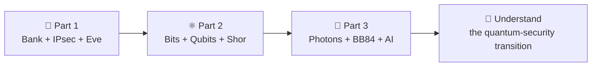

# 🔐 Quantum Security 101

### From Breaking RSA to Quantum Key Distribution with AI

**One fictional bank. Three interactive notebooks. A journey from classical encryption to quantum-safe communication.**

**28 October 2026 · 12:00–1:00 PM (Bahrain time) · Gulf Convention Centre, Gulf Hotel, Bahrain**

**Workshop conducted by Limnesh Augustine**  
Project Manager · Gulf Business Machines (GBM), Bahrain

[**🚀 START THE WORKSHOP**](#-open-the-three-notebooks) · [**🧪 THE EXPERIMENTS**](#-what-youll-explore) · [**👨‍🚀 ABOUT THE PRESENTER**](#-about-the-presenter) · [**📚 RELATED PROJECTS**](#-continue-exploring)

---

## 👋 Welcome, quantum explorers!

Imagine you are the security administrator of **Bahrain Sample Bank (BSB)**, a fictional bank with a production data centre in **Manama**, a disaster-recovery site in **Sitra**, and another in **Dubai**.

Your bank encrypts its communications. **Eve** records a protected exchange today, hoping that tomorrow's quantum computers will let her read it. Can she? What does Shor's algorithm actually attack? And could photons help Alice and Bob agree on fresh secret keys instead?

We will answer those questions by **running the experiments**, not just looking at slides.

> **No quantum computer, laser, or Python installation is needed.** A laptop, web browser, internet connection and Google Colab are sufficient for the simulated labs.

## 🚀 Open the three notebooks

Work through them **in order**. Each notebook contains explanations, runnable Python cells and interactive controls.

| | Workshop notebook | Launch in Google Colab | What you will do |
|---|---|---|---|
| **01 🏦** | **BSB Banking, IPsec & Harvest Now–Decrypt Later** [`01_ClassicalSecurity.ipynb`](https://github.com/limnesh/BITEX/blob/main/01_ClassicalSecurity.ipynb) |  | Observe key exchange, encrypt a banking record, and see what Eve can record. |
| **02 ⚛️** | **From Classical Bits to Qubits and Shor's Algorithm** [`02_QuantumComputing.ipynb`](https://github.com/limnesh/BITEX/blob/main/02_QuantumComputing.ipynb) |  | Experiment with Bloch spheres, gates, measurements, and the quantum threat to public-key cryptography. |
| **03 🔦** | **Quantum Key Distribution, Satellites & Machine Learning** [`03_QKDandML.ipynb`](https://github.com/limnesh/BITEX/blob/main/03_QKDandML.ipynb) |  | Send simulated photon pulses; explore BB84, Eve, QBER, reconciliation, privacy amplification, SKR and AI. |

**📂 [Browse all workshop files on GitHub](https://github.com/limnesh/BITEX)**

**If a Colab button cannot find a file:** open the [BITEX repository](https://github.com/limnesh/BITEX), select the corresponding numbered `.ipynb` notebook, or open [Google Colab](https://colab.research.google.com/), choose **File → Open notebook → GitHub**, search for `limnesh/BITEX`, and select the notebook.

### ▶️ How to run a lab

1. Click **Open in Colab** for the notebook you want. Sign in to Google if prompted.
2. In Colab, run the **Setup / Initialization** code cell near the beginning using the **▶** button. Allow the first installation to finish.
3. Follow the notebook from top to bottom. **🔵 LIVE — Step 1, Step 2, Step 3…** are the guided workshop activities. **🟠 OPTIONAL** means extra exploration afterward.
4. Change a slider, select a basis or gate, press **Measure**, and **observe how the results change**. Execute each experiment's cell before using its controls.
5. To keep your experiments, choose **File → Save a copy in Drive**. Your own copy can be edited without changing this repository.

**Tip:** If an import fails, run the notebook's Setup cell. If you have executed cells out of order and a variable is missing, use **Runtime → Restart session** and run the cells again in sequence. A standard CPU runtime is sufficient for these demonstrations.

---

## 🧪 What you'll explore

### 🏦 Part 1 — Can Eve read BSB's banking data?

**From encrypted bank replication to a captured IPsec-style handshake**

- Follow a fictional Manama → Sitra → Dubai disaster-recovery scenario.
- See a **toy Diffie–Hellman** public exchange and how both parties derive the same shared secret.
- Encrypt a sample record using **AES-GCM**; observe the public data and ciphertext available to Eve.
- Explore **Harvest Now, Decrypt Later** and why the security of a key exchange matters even when the data-encryption algorithm remains strong.
- Compare illustrative classical attack-work scales; understand why those are **not measured cracking times**.

**Try this:** Change the banking message. Can Eve read it from the captured ciphertext alone?

### ⚛️ Part 2 — From a bit to a quantum attack

**Classical logic → Qubit → Measurement → Entanglement → Shor**

- Convert numbers to binary and build arithmetic from familiar **NOT, AND, OR and XOR** operations.
- Explore six reference states on the **Bloch sphere**, prepare random qubits, and measure them.
- Compare **ordinary gates** with two-qubit interactions that **can create entanglement**.
- Investigate Shor's **discrete-logarithm** threat to Diffie–Hellman and an **optional compiled RSA factorization** example.
- Compare published *theoretical* fault-tolerant quantum resource estimates with illustrative classical work models.

**Try this:** Why does CNOT entangle `|+⟩|0⟩` but not `|0⟩|0⟩`?

### 🔦 Part 3 — Can photons help us distribute a secret key?

**Optical channel → BB84 → Eve → Keys → Satellites → ML**

- Adjust **laser power, pulse width and attenuation** across the **Transmitter → Medium → Receiver** dashboard.
- Encode a bit in a **BB84 basis**, choose Bob's basis and see **matched vs unmatched** measurements with Bloch spheres.
- See how **intercept–resend** can increase **QBER (Quantum Bit Error Rate)**.
- Compare signal and decoy intensities (**μ = 0.50** and **μ = 0.15**) in a simplified photon-number-splitting example.
- Edit **16-bit Alice/Bob/Eve strings** and observe reconciliation, what public error-correction information can reveal, and **Toeplitz privacy amplification**.
- Explore modeled **Secret Key Rate (SKR)**, satellite links and **machine-learning-assisted parameter selection**.

**Try this:** Increase Eve's interception percentage. What happens to QBER—and can privacy amplification repair a key that is already completely known to Eve?

---

## 🎯 Your workshop mission

By the end of the session, try to explain these four ideas in your own words:

| Question | Clue |
|---|---|
| **1.** Why can ciphertext captured *today* be at risk *later*? | Think about the original key exchange. |
| **2.** Why is a qubit not simply a bit that can be read twice? | Prepare, change basis and measure. |
| **3.** How do Alice and Bob detect some forms of interference? | Compare their bases and a sample of their sifted bits. |
| **4.** Why do error correction and privacy amplification have different jobs? | One reconciles errors; the other reduces information available to Eve. |

> 🧭 **Remember:** QKD distributes key material; it does **not** directly encrypt a banking application or replace authentication. The notebooks use idealized educational simulations—not real single-photon transmissions, a production VPN, or a demonstrated large-scale Shor attack.

---

## 👨‍🚀 About the presenter

**Limnesh Augustine** is an **IT Project Manager at Gulf Business Machines (GBM), Bahrain**, with more than two decades of experience across enterprise technology, infrastructure and project delivery. He holds a **B.Tech in Electronics and Communication Engineering (University of Calicut, 2003)** and is pursuing an **IIT Delhi postgraduate diploma in Advanced Communication Engineering with Quantum & AI Integration**.

His interest in quantum communication combines an engineering background with hands-on simulation and programming. His work includes studying **Differential Phase Shift Quantum Key Distribution (DPS-QKD) over Free-Space Optical (FSO) channels**, atmospheric effects, satellite communication scenarios and **ML-assisted parameter optimization**.

But engineering is only one side of the story:

- **🎨 Art and perspective:** Together with artist and educator **Jincy Babu**, Limnesh is part of **[3D Couple](https://3dcouple.com/)**, creating international 3D anamorphic/street art, including Guinness World Record achievements and educational workshops. Their work is a reminder that *what we observe depends on how we look*—an evocative parallel to measurement in quantum physics, though not a literal explanation of quantum mechanics.
- **✈️ Aviation and communication:** As a private pilot and aviation enthusiast, he also develops **[ATCSpeak](https://www.atcspeak.com/about)**, an aviation radio-communication practice project connecting technical learning with realistic training scenarios.
- **💡 Technology and exploration:** His interests connect enterprise systems, cybersecurity, optical communications, interactive programming, aviation and public art—fields that might seem unrelated until an experiment brings them together.

*This is an independent educational workshop; professional affiliations identify the presenter and do not imply that the sample bank or simulations are production systems.*

## 📚 Continue exploring

| Project / website | Explore |
|---|---|
| **DPS-QKD over Free-Space Optical Channels — Project Report** | [📖 Read the interactive research report](https://limnesh.github.io/QuantumKeyDistribution-DPS/DPS_QKD_FSO_Project_Report_v1.0.html) |
| **Differential Phase Shift QKD — Source and simulations** | [💻 Explore the DPS-QKD repository](https://github.com/limnesh/QuantumKeyDistribution-DPS) |
| **Free-Space Optical Communication — Related project** | [🔭 Explore the FSO repository](https://github.com/limnesh/QuantumKeyDistribution-FSO/) |
| **3D Couple — Art that changes perspective** | [🎨 Visit 3dcouple.com](https://3dcouple.com/) |
| **ATCSpeak — Aviation communication practice** | [✈️ Visit ATCSpeak](https://www.atcspeak.com/about) |
| **Workshop source files and updates** | [🔐 GitHub · limnesh/BITEX](https://github.com/limnesh/BITEX) |

---

<strong>🛠️ Troubleshooting and important notes</strong>

- **The notebook opens but a button does nothing:** Run its setup and relevant widget-creation cell. In Google Colab, interactive widgets require the notebook runtime to be connected.
- **`ModuleNotFoundError` (Qiskit, scikit-learn, etc.):** Run the Setup cell. A fresh Colab environment does not always have all dependencies installed.
- **`NameError` or missing variables:** A previous cell has not run. Restart the session and follow the notebook order.
- **Charts or measurements change each time:** Some demonstrations intentionally use randomness. Quantum simulations are often sampled, and ML models may involve stochastic training.
- **A toy 9-bit DH example is broken quickly:** That is intentional. It illustrates the mathematics; it is not the security level of a modern 2048-bit finite-field DH group.
- **A displayed quantum circuit includes modular-operation placeholders:** The architecture diagram should not be mistaken for a fully implemented, runnable fault-tolerant Shor circuit.
- **A secret key rate is displayed:** Treat it as a model output under stated assumptions, not a deployment guarantee or a composable finite-key security proof.

### Keep experimenting. Ask why. Change one variable. Observe the result.

**From 0 and 1 to photons, phase, and the future of secure communication.**

⭐ If these materials helped you, consider starring the [BITEX repository](https://github.com/limnesh/BITEX).

